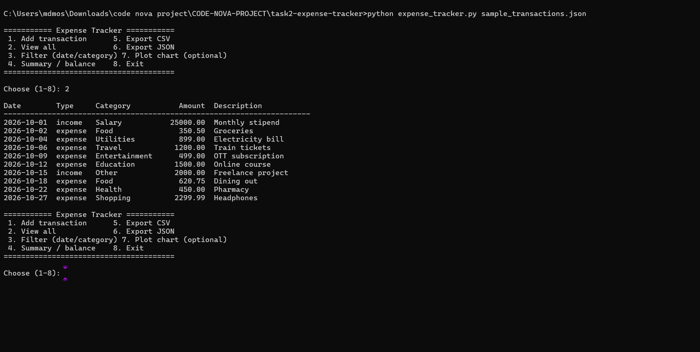
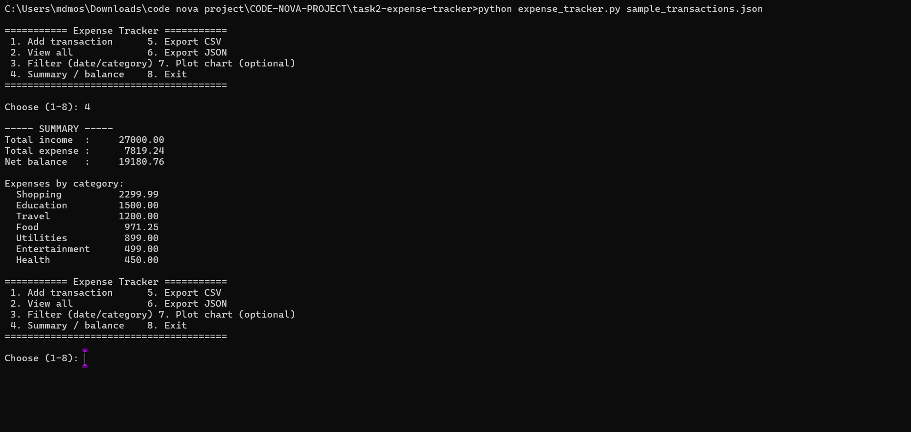
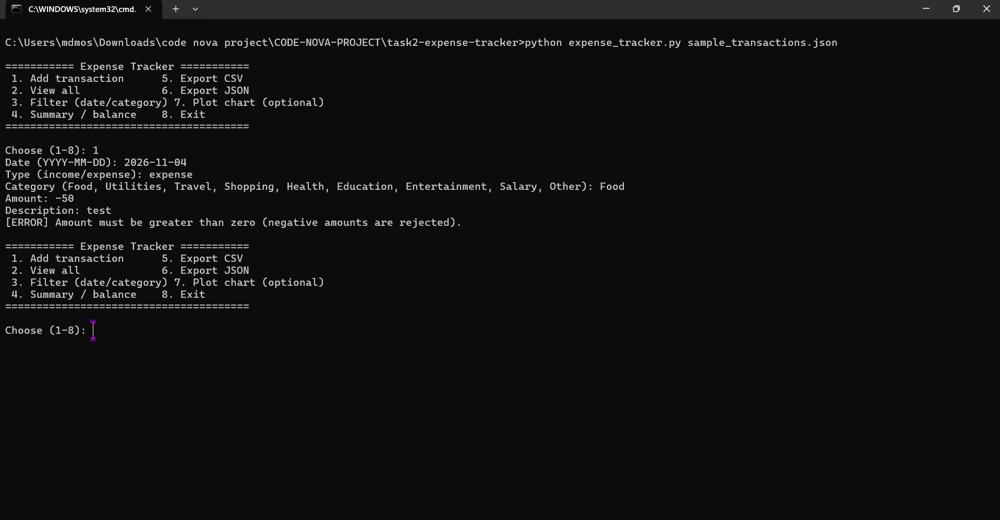

# Task 2 — Expense Tracker

Interactive CLI to record income/expenses, view balances, filter, and export reports.

## Features
- Transactions: date, type (income/expense), category, amount, description
- Net balance, total income, expenses per category
- Filter by date range and/or category
- Export to **CSV** or **JSON**; data persists in `transactions.json`
- Optional pie chart (`pip install matplotlib`)

## Financial logic
All money uses Python's `Decimal` (rounded to 2 places, half-up), so there are no floating-point errors (0.1 + 0.2 = 0.30).
- `balance = total income − total expense`
- Category totals sum only *expense* transactions
- Date filtering is inclusive on both ends

## Validation
Rejects negative/zero/non-numeric amounts, malformed or impossible dates (e.g. `2026-13-45`), unknown categories/types, and start date after end date.

## Run
```bash
python make_sample_data.py                      # creates sample_transactions.json
python expense_tracker.py sample_transactions.json
python test_expense_tracker.py                  # tests
```

## Sample report (from sample_transactions.json)
```
Total income  :     27000.00
Total expense :      7819.24
Net balance   :     19180.76
```

## Screenshots





